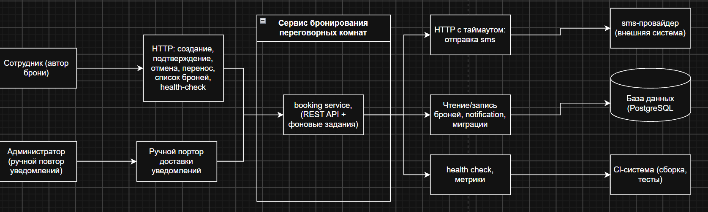
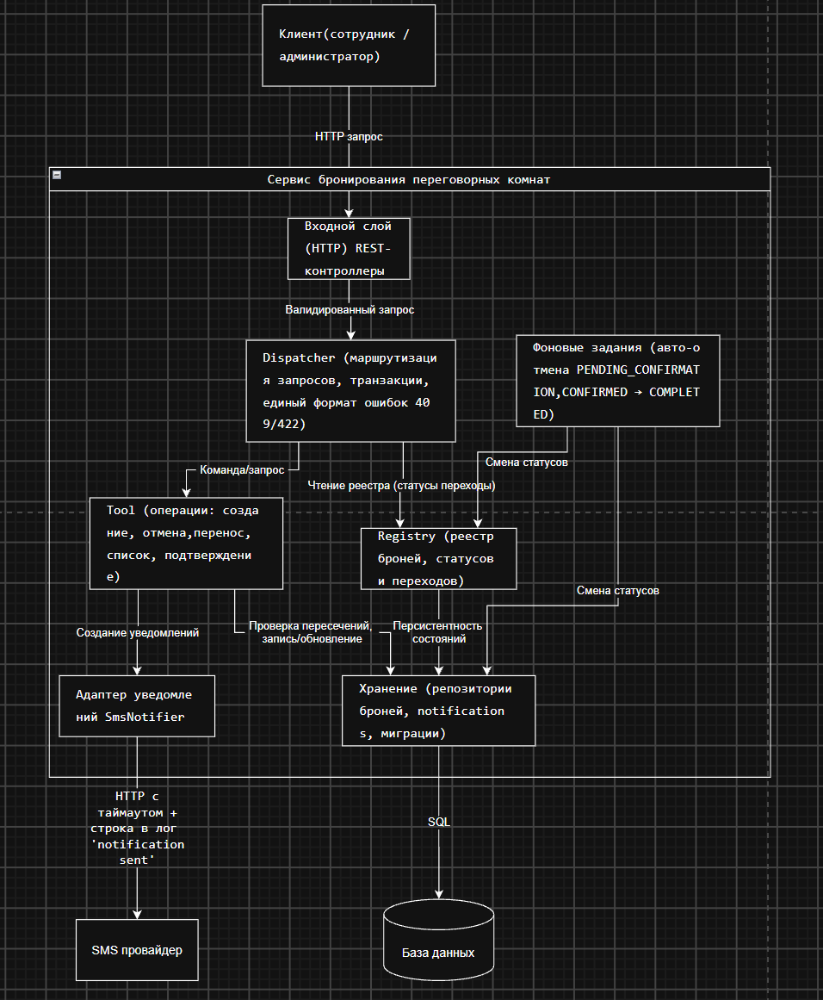
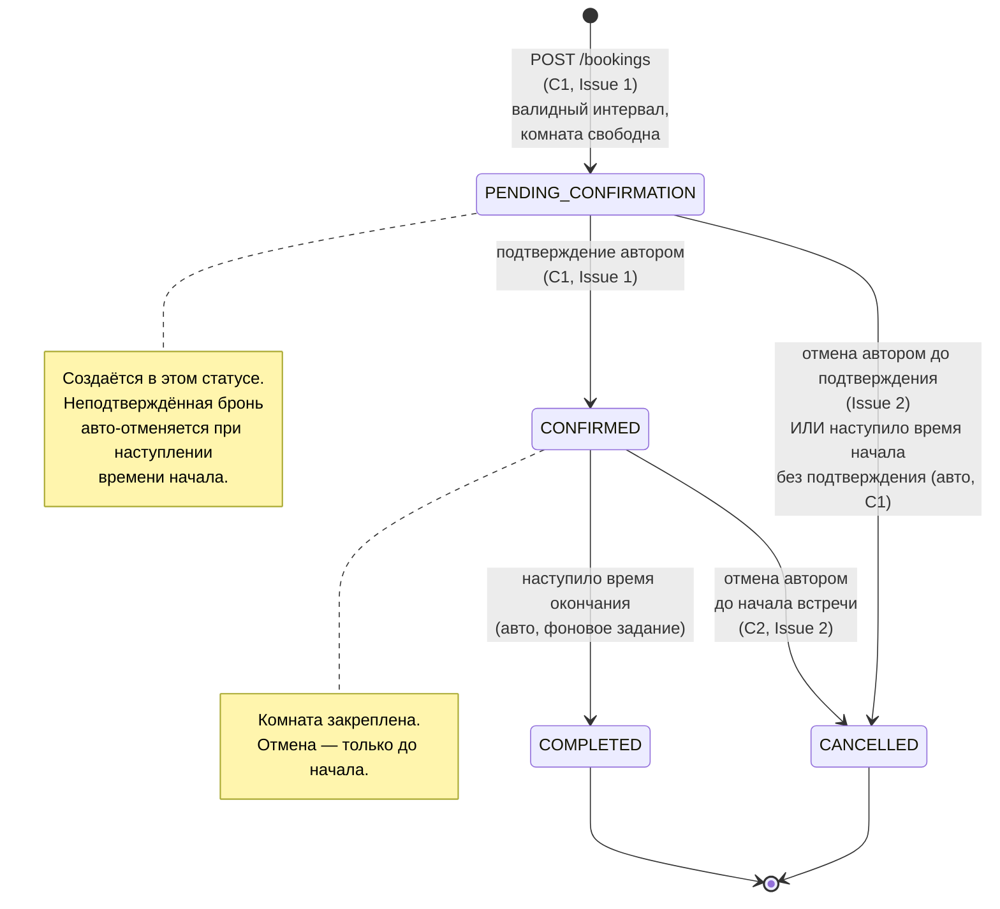

# Архитектура сервиса бронирования

[Исходник схем контекста и компонентов](diagrams/architecture.drawio)

## Контекст

Стрелки - это вызовы (потоки данных/запросы) между системой, её пользователями и внешними системами на уровне Context — не зависимости кода. Сотрудник и администратор обращаются к сервису по HTTP; сервис синхронно вызывает SMS-провайдера (HTTP с таймаутом, Issue 7), работает с БД (Issue 5: уникальное ограничение по комнате и интервалу + транзакция; Issue 8: миграции) и отдаёт health-check для CI (Issue 8). Внешние системы: SMS-провайдер, БД, CI. Управление штатным расписанием, физическим доступом, оборудованием и видеоконференциями — вне границ (раздел 7 описания сервиса). 

## Компоненты

Стрелки на уровне Component показывают зависимости кода (кто кого вызывает/от кого зависит при обработке запроса), а не потоки данных контекста. Входной слой зависит от Dispatcher, Dispatcher — от Tool и Registry, Tool — от Storage и Notifier, Scheduler — от Registry и Storage, Storage — от БД (SQL), Notifier — от внешнего SMS-провайдера. Обратные стрелки отсутствуют: каждый компонент скрывает свои детали от соседей. 

| Компонент | За что отвечает | Что скрывает от соседей |
| --- | --- | --- |
| Входной слой (HTTP) | Принимает REST-запросы (POST /bookings, DELETE /bookings/{id}, PATCH /bookings/{id}, GET /bookings, GET /health), валидирует формат (Issue 6: 422) | Детали протокола, сериализации, аутентификации/авторизации автора брони; отдаёт дальше уже валидированный запрос |
| Dispatcher | Маршрутизирует запрос к нужной операции Tool, управляет транзакцией (Issue 5), приводит ошибки к единому формату 409/422 (Issue 8) | Конкретные реализации операций и репозиториев; соседи видят только «команду»/«запрос» и унифицированный ответ |
| Registry | Хранит реестр броней и правила переходов жизненного цикла (PENDING_CONFIRMATION → CONFIRMED/CANCELLED, CONFIRMED → CANCELLED/COMPLETED) | Как именно состояния персистентятся и проверяются переходы; Tool и Scheduler видят только «текущий статус» и «разрешён ли переход» |
| Tool | Выполняет бизнес-операции: проверка пересечений и статуса комнаты, создание (Issue 1, С1), отмена (Issue 2, С2), перенос (Issue 3, С3), список своих броней с сортировкой/фильтрами/пагинацией (Issue 4, С4) | Алгоритмы проверки пересечений, сортировки и фильтрации; наружу — только результат операции |
| Хранение (Storage) | Репозитории броней и notifications, уникальное ограничение по комнате и интервалу, миграции с нуля (Issue 5, 7, 8) | SQL, схему таблиц, детали транзакций и блокировок; соседи работают с доменными объектами, а не с таблицами |
| Адаптер уведомлений (SmsNotifier) | Пишет запись в notifications при создании/отмене/переносе (Issue 7), шлёт HTTP-запрос к SMS-провайдеру с таймаутом, пишет в лог строку notification sent с типом и id брони | Детали внешнего API SMS-провайдера, таймауты, формат лога; для Tool это просто «отправить уведомление» |
| Фоновые задания (Scheduler) | Авто-отмена неподтверждённой брони при наступлении времени начала (PENDING_CONFIRMATION → CANCELLED) и завершение встречи (CONFIRMED → COMPLETED) | Расписание запуска и механизм триггеров; Registry/Storage видят только запрос на смену статуса |

## Диаграмма состояний Job

## Разрешенные переходы

| Из | В | Триггер | Источник |
| --- | --- | --- | --- |
| [*] | PENDING_CONFIRMATION | POST /bookings — создание (С1, Issue 1) | С1, Issue 1 |
| PENDING_CONFIRMATION | CONFIRMED | Автор подтвердил бронь (С1) | С1, Issue 1 |
| PENDING_CONFIRMATION | CANCELLED | Автор отменил до подтверждения | Issue 2, жизненный цикл |
| PENDING_CONFIRMATION | CANCELLED | Наступило время начала без подтверждения (авто, фоновое задание) | С1, п. 6 описания |
| CONFIRMED | CANCELLED | Автор отменил до начала встречи (С2) | С2, Issue 2 |
| CONFIRMED | COMPLETED | Наступило время окончания (авто, фоновое задание) | п. 6 описания |

## Запрещенные переходы и ответ системы

| Попытка | Почему запрещён | Ответ системы |
| --- | --- | --- |
| CONFIRMED → CANCELLED, если время начала уже наступило | Отмена подтверждённой брони возможна только до начала (С2, п. 5 описания) | 409 Conflict (единый формат ошибки, Issue 8) — «встреча уже началась, отмена невозможна» |
| PENDING_CONFIRMATION → CONFIRMED, если время начала уже наступило | Неподтверждённая бронь к этому моменту уже авто-отменена (PENDING_CONFIRMATION → CANCELLED, п. 4) | 409 Conflict — «бронь уже отменена (истекло время подтверждения)» |
| Подтверждение из CANCELLED или COMPLETED | Терминальные состояния, переходов нет | 409 Conflict — «недопустимый переход статуса» |
| Отмена из CANCELLED | Уже отменена | 409 Conflict — «бронь уже отменена» |
| Отмена из COMPLETED | Встреча прошла, отменять нечего | 409 Conflict — «встреча завершена» |
| Перенос (PATCH /bookings/{id}) из CANCELLED / COMPLETED | Перенос допустим только из CONFIRMED или PENDING_CONFIRMATION (С3) | 409 Conflict — «перенос невозможен из текущего статуса» |
| Создание с началом в прошлом | Нельзя бронировать прошедшее время (С6, п. 5) | 422 Unprocessable Entity — «начало в прошлом» (С6, Issue 6) |
| Создание с концом раньше начала / нулевой длительностью | Некорректный интервал (Issue 6) | 422 Unprocessable Entity — понятное сообщение о некорректном интервале |
| Создание/перенос на пересекающийся интервал той же комнаты | Двойное бронирование запрещено (С5) | 409 Conflict с идентификатором конфликтующей брони (Issue 5, 8) |
